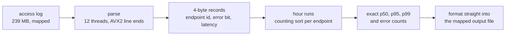

# Track A: Ingest

Read an access log and summarise it: for every hour and endpoint that saw traffic, print the
request count, the exact 50th, 95th and 99th latency percentiles, the error count and the errors
per million.

| | Reference | This entry |
|---|---|---|
| Time, full dataset, seed 1 | 32.05 s | **16.6 ms** |
| Peak memory | 228 MB | **16.9 MB** |
| Code lines | 56 | 344 |
| Board points | 0 | **87.6** |

That is about 1,900× the reference's speed on the board's dataset. Every step that got here, with
the board run ID that measured it, is in [PERF.md](PERF.md).

## Approach



1. **Map, don't read.** The log is mapped read-only and cut into one chunk per thread at line
   breaks. Nothing is copied on the way in.
2. **Parse once.** Each thread turns a line into a 4-byte record: endpoint id, error bit and
   latency. Latencies too large for the record's 20 bits go to a side list. Endpoint names become
   small integers through one table that all threads share, so the name is compared once per
   occurrence and never stored per line.
3. **Keep the file's order.** Lines arrive in long runs of one hour, so the records stay in file
   order and each thread records where its runs of an hour start. No hour is stored per line, and
   there is no sort over the 3.1 million lines.
4. **Summarise an hour at a time.** Threads take hours smallest first. For one hour a thread
   walks that hour's runs in every chunk, counts lines per endpoint, places each latency with a
   counting sort, and picks the percentiles by rank. The hour's records are freed as soon as they
   are read, which is why the peak stays at 17 MB.
5. **Write in place.** Once every hour's length is known the output file gets its final size and
   is mapped. Each thread formats hours directly into the file and returns its pages.

## Why it is fast

- **One pass over 239 MB.** The log is ten times the L3 cache, so a second pass would stream from
  main memory again. It is parsed once into 12 MB of records instead.
- **No byte-by-byte scanning.** AVX2 compares find a line's end; the latency, the status and the
  endpoint's end are read backwards from it at fixed offsets, and the latency's digits convert in
  one SWAR step.
- **Cache-sized work.** One hour is about 43,000 lines, so its 170 KB latency buffer stays in L2
  through the counting sort and the selection.
- **Nothing is torn down.** The process exits right after the write. Threads hand their records
  and their share of the mapping back to the kernel in parallel, and the input is unmapped before
  memory peaks.
- **Percentiles are exact.** Nearest rank on a counting sort, not an approximation, so the output
  hashes match the reference on every seed.

## Dependencies

None. The program is Rust with no crates, built offline from the pinned `rust:1-slim-trixie`
image, and the Dockerfile is a two-stage build so the final image is just the static binary.

```
cd track-a && cargo build --release --offline
```

`target-cpu=alderlake` (in `.cargo/config.toml`) keeps the AVX2 paths legal on the scoring box.
Build with the same toolchain as the image, `cargo +1.99.1`.

## With another 24 hours

The remaining time is the parse and the kernel's page-fault work around it. `perf` puts the parse
at 26% of kernel samples (`next_uptodate_folio`, fault-around), and 47% of the formatting phase in
`shmem` page-cache insertion. Two next steps: fault the output pages before the hour pass so the
formatter never takes a fault in its inner loop, and give the parse its own mapped copy of the
input to see whether fault-around scales with more threads. The two barriers plus the leader's
serial sort cost 0.36 ms, 2.2% of the run, which is the other thing worth attacking.
