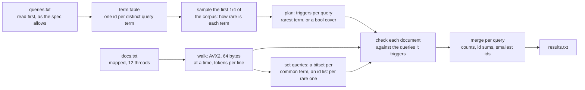

# Track B: Index

Answer 50,000 queries over a corpus of about 250,000 documents. Each answer is the number of
matching documents, the sum of their ids and the ten smallest ids. A query is a boolean
expression evaluated strictly left to right, or an exact phrase.

| | Reference | This entry |
|---|---|---|
| Time, full dataset, seed 1 | 56.35 s | **90.6 ms** |
| Peak memory | 2,200 MB | **41.8 MB** |
| Code lines | 91 | 901 |
| Board points | 0 | **79.4** |

About 620× the reference's speed. Every step, with the board run ID that measured it, is in
[PERF.md](PERF.md).

## Approach



1. **Queries first.** `queries.txt` is read before the corpus (spec §3 allows it) and every
   distinct query term gets a small id. The corpus is then indexed only for the terms the queries
   use; a token no query mentions is looked up once and forgotten.
2. **Triggers.** Tokenising the first quarter of the corpus estimates how many documents hold each
   term. Each query then gets triggers: terms such that every matching document contains at least
   one of them. A phrase uses its rarest term; a boolean query uses a cover of its terms. Triggers
   decide how much work is done and never the answer, so a wrong estimate costs time, not
   correctness.
3. **One pass over the corpus.** Each thread scans a chunk of whole lines, and an AVX2 classifier
   finds token starts, token ends and line ends 64 bytes at a time. At the end of each document,
   the queries its triggers point at are checked against that document alone: a phrase at each
   position of its trigger term, a boolean query through one lookup in a truth table of which of
   its terms this document contains. Set operations applied per document give the same answer as
   combining whole posting lists (spec §3).
4. **Sets stay as bitsets.** A boolean query whose cover contains a common term would be checked
   on too many documents, so it is evaluated on whole sets instead: a bitset per common term and
   an id list per rare one, window by window, then merged.
5. **Merge.** Per query, chunk counts and id sums add and the smallest ids come from the earliest
   chunks.

## Why it is fast

- **Index only what the queries ask for.** 79% of the corpus's tokens are query terms, but the
  other 21% cost one hash lookup and nothing else, and no posting list is ever written for a term
  no query uses.
- **Half the work is skipped per document.** A phrase is checked only at its rarest term's
  positions, and a boolean query only in documents holding its trigger set.
- **The scan is bit-level.** Token and line boundaries come from AVX2 compares on 64-byte blocks,
  not from a byte loop; a block's starts, ends and line feeds are three masks, and the token loop
  packs eight tokens at a time.
- **Memory stays flat per thread.** Per query a count, an id sum and the first matches; per kept
  term one window of documents. No posting list for the whole corpus is ever materialised, which
  is why the peak is 42 MB against the reference's 2.2 GB.

## Dependencies

None. Zero-crate Rust, built offline from the pinned `rust:1-slim-trixie` image.

```
cd track-b && cargo build --release --offline
```

The binary is static, non-PIE, and built for `alderlake` (`.cargo/config.toml`), which is the
scoring box's feature set. Build with `cargo +1.99.1`.

## With another 24 hours

The pass costs about 110 instructions per token, and 51.7% of samples sit in the line-end closure
that consumes each line's probe list. Two directions: batch a line's probes so the posting-slot
updates run without the per-token `Vec` push, and try a cheaper hash than the current single
multiply for the common terms. Memory also needs headroom: runs land between 42 and 46 MB against
the 44 MB cap, so a run that crosses it loses a fraction of a point on the memory axis. Shaving
4 MB is worth more than another 1% of time.
