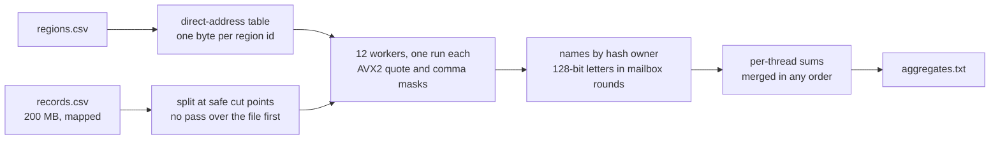

# Track C: Join

Join a 200 MB CSV of records against a small region table and print one line of aggregates per
country: record count, id sum, amount sum, min, max, distinct names, and the byte lengths of the
names and notes after unescaping.

The CSV is hostile on purpose. Names and notes are quoted, `""` is one `"`, a note can contain a
bare newline, records end in CRLF or LF, and a byte order mark can start any record. The output
has to match the reference byte for byte anyway.

| | Reference | This entry |
|---|---|---|
| Time, full dataset, seed 1 | 14.44 s | **19.3 ms** |
| Peak memory | 367 MB | **11.3 MB** |
| Code lines | 108 | 348 |
| Board points | 0 | **83.1** |

About 745× the reference's speed. Every step, with the board run ID that measured it, is in
[PERF.md](PERF.md).

## Approach



1. **The lookup is a direct-address table.** Countries are numbered in the order their first rows
   are read, and the table maps a region id to a group number in one byte. A missing id reads as
   group 0, which is the unmatched row, so there is no comparison in the hot path.
2. **The split knows about quotes.** The file is cut into one run per worker, and a cut can land
   inside a quoted note where a newline is data. Each run starts at the first newline after its
   cut that a digit or a byte order mark follows (spec §2.2), so no pass over the file is needed
   before the real one.
3. **Fields are measured, not unescaped.** For each record an AVX2 compare builds masks of the
   quotes and commas in the 64 bytes at the name, and the ends of the name and the note come out
   of both masks at once. A field's unescaped length is its raw length minus one per `""` pair, so
   no field is ever copied or rewritten. The id converts from one 8-byte word, and the region id
   and amount from one 16-byte vector, with no digit loop.
4. **Names are sharded by hash, not locked.** Each distinct name belongs to one thread that keeps
   a hash table with 64 bits of the name's hash and one bit per country. Threads trade 16-byte
   letters (128-bit hash plus group) in rounds with a barrier between them, so no table line ever
   bounces between cores and there is no atomic per record.
5. **The output order is free.** Codes are written bytewise, so the country order falls out of the
   table without a sort, and per-thread integer sums merge in any order.

## Why it is fast

- **No unescaping pass.** The length of an escaped field is arithmetic on the raw bytes, so the
  parser never rewrites data and never allocates a string.
- **Commas and quotes in one compare.** Both field separators come from the same AVX2 mask, so a
  record is walked field by field without a byte loop.
- **No atomics in the record path.** Sharding names by hash turns the contention the reference has
  into one atomic per thread per round, at the barrier.
- **11 MB of memory.** The input is mapped and never copied; what is allocated is the name sets,
  the mailboxes and the region table.

## Dependencies

None. Zero-crate Rust, built offline from the pinned `rust:1-slim-trixie` image.

```
cd track-c && cargo build --release --offline
```

`target-cpu=alderlake` in `.cargo/config.toml`. Build with `cargo +1.99.1`.

## With another 24 hours

The probe loop and the barrier waits are what is left. Names and notes are hashed still escaped,
which is exact but touches every byte twice when a note is long; a fast path for the common case
of an unquoted, unescaped field would shorten the parse. Memory is 11.3 MB against a 7.3 MB cap,
so the name sets and the mailbox pages are the two places where another megabyte would pay. Twelve
workers is 7% faster locally but loses about 4 points on one board run in five when the box is
busy; a cheap in-process contention check that falls back to eleven workers would keep the fast
path without the tail risk.
