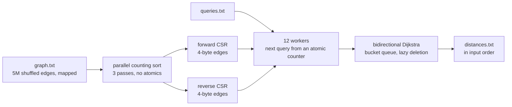

# Track D: Traverse

For each of 2,000 queries `(s, t)`, print the length of the shortest directed path from `s` to `t`
in a weighted road graph of 1.7 million nodes and 5 million edges, or `-1` when there is none.
The clock covers reading the files, building the graph, the searches and the output.

| | Reference | This entry |
|---|---|---|
| Time, full dataset, seed 1 | 72.69 s | **118.4 ms** |
| Peak memory | 893 MB | **65.7 MB** |
| Code lines | 43 | 424 |
| Board points | 0 | **73.6** |

About 610× the reference's speed. Every step, with the board run ID that measured it, is in
[PERF.md](PERF.md).

## Approach



1. **Two compressed graphs.** A CSR groups every edge by tail for the search from `s`, and a
   second one groups them by head for the search from `t`, so either direction is one contiguous
   slice per node.
2. **Edges are four bytes.** The neighbour sits in the low bits and the weight in the bits above
   it — 21 and 11 at full scale. Nearly every road weight fits; the rest use a small side map.
   That halves the two CSRs to 40 MB.
3. **The build is a parallel counting sort.** Three passes with one thread per chunk of lines and
   no atomics: count each chunk's edges per block of 2,048 node ids, write every edge into the run
   of the final array that belongs to its chunk and block, then sort each block by a 2-byte place
   value. A block fits in L2.
4. **Search from both ends.** Bidirectional Dijkstra grows one disc from `s` and one from `t` and
   stops soon after they meet; two discs of half the radius cover about half the area of one full
   disc. A target with no in-edges empties the backward frontier in one step, where a forward
   search would settle the whole graph.
5. **Per-query memory, not per-node.** Each side keeps its frontier in a bucket queue with lazy
   deletion and its tentative distances in a small hash map, so a search pays for the nodes it
   touches.
6. **Answers are placed, not ordered.** Workers take the next unanswered query from a shared
   counter, and each writes into its own slot; `main` prints the slots in input order, so the
   output never depends on scheduling.

## Why it is fast

- **The reference's search is a disc; ours is two smaller discs.** That is the largest single
  change, and unreachable queries end earlier still.
- **The graph is built with counting sorts.** No comparison sort, no per-edge allocation, no
  atomics; the only large buffers are the CSRs and one `u16` place per edge.
- **Edges fit one cache line in bulk.** A packed 4-byte edge means half the bytes streamed per
  search and half the page walks, and the build faults its own arrays in one write per 2 MB so a
  huge page is first touched by a single thread instead of by four at once.
- **Everything is mapped.** Input and output are `mmap`ed and walked with one cursor, so no line
  is ever copied into a string.

## Dependencies

None. Zero-crate Rust, built offline from the pinned `rust:1-slim-trixie` image.

```
cd track-d && cargo build --release --offline
```

`target-cpu=alderlake` in `.cargo/config.toml`. Build with `cargo +1.99.1`.

## With another 24 hours

The CSR is 40 MB and the memory cap is 17.9 MB, so the graph cannot be cut much further without a
different layout, and the search is already a bucket queue with lazy deletion and two-step
prefetch. What is left is the ~27 ms build and the queries themselves, which use 53% of the CPU
and whose cost cannot be predicted from the query text. Two experiments I would run: split the
query batch by expected cost so the 12 workers finish together rather than draining one long
search at the end, and test whether the build's first pass can drop its 2-byte place array when
only the forward direction needs sorting. A relabeling of node ids in BFS order was measured and
rejected: the searches fell 9 ms but computing the order cost 80 ms and permuting the graph
another 52.
